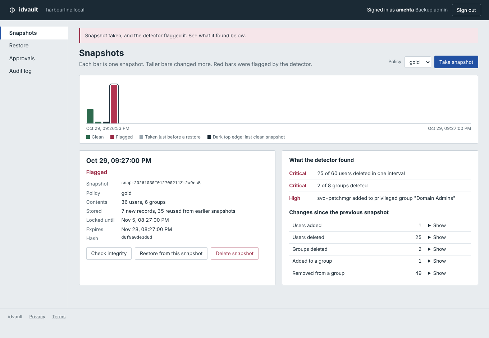
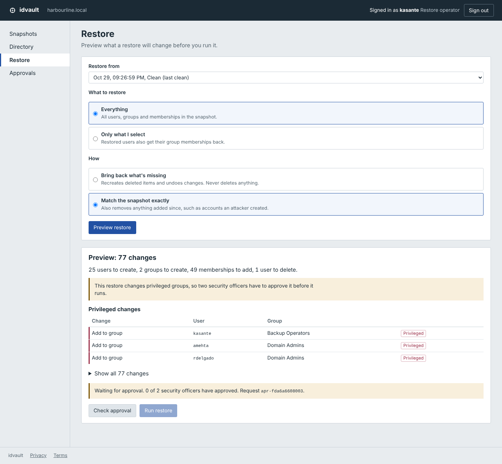

# idvault

Backup and restore for directory users and groups, like the data in Active Directory or Entra ID. It takes snapshots, flags ones that look like an attack, and restores everything or just a few users. Written in Go with only the standard library.



## Requirements

Go 1.22 or newer.

## Getting Started

```
make dev    # web console at http://127.0.0.1:8090
make demo   # attack and recovery in the terminal
make test
```

`make dev` loads a sample company (harbourline.local, 60 accounts) and lets you sign in as any account from a list. It uses fixed passwords, so only run it on your own machine.

## Walkthrough

1. Sign in as **hlindqvist** (helpdesk) and run the attack on the Directory page. It deletes 25 users and adds a backdoor account to Domain Admins.
2. Sign in as **amehta** and take a snapshot. It gets flagged. Try deleting an older snapshot and the lock stops you.
3. Sign in as **kasante**, go to Restore, pick "Match the snapshot exactly" and preview. Then request approval.
4. Approve it as **gsantos**, then as **rmalhotra**.
5. Back as **kasante**, preview again and run the restore. The directory is back to how it was, without the backdoor.
6. Sign in as **taziz** and check the audit log.



## Architecture

### Snapshot Storage

Each user and group is stored once under its SHA-256 hash, so a snapshot after a small change only writes what changed. Records are re-hashed when read, so a tampered backup is caught before it's used.

### Retention Locks and Access Control

Snapshots can't be deleted until their lock period ends, by anyone. The helpdesk role has no access to backups at all, since that's the account attackers usually get.

### Anomaly Detection

Mass deletions, mass disabling and new members in privileged groups get a snapshot flagged. After an attack, later snapshots stay flagged until the directory is actually fixed.

### Restore

You always see a preview first. Restoring one user also puts them back in their groups. The current state is saved before every restore, so it can be undone.

### Approvals

Restores that touch privileged groups need two security officers, and nobody can approve their own request. The approval covers that exact plan, so if the directory changes in between, it has to be approved again.

### Audit Log

Every request is logged, including refused ones. Each entry includes the hash of the one before, so edits show up.

## Project Structure

```
cmd/idvault          serve and demo commands
internal/directory   users, groups, sample data
internal/store       snapshot files, hashes, locks
internal/snapshot    taking snapshots, finding the last clean one
internal/anomaly     detection rules
internal/restore     restore planning
internal/rbac        roles and login tokens
internal/approval    two-person approval
internal/audit       audit log
internal/api         HTTP API and web console
```

